# Test Documentation – Project Milestone 2

**Team:** Igory  
**Project:** Monitoring and Predicting Flight Disruptions in Near Real Time (`flight-disturbance`)  
**Scope:** Data Acquisition (OpenSky, Tomorrow.io, NOAA SWPC, SeismicPortal), Buffering (SNS/SQS FIFO), Data Lake Preprocessing (S3 Bronze -> Silver), and Operational Monitoring (CloudWatch)  
**Target AWS Environment:** `eu-north-1` (Stockholm), Account `592964949672`, Python `3.12` / `3.13`, Terraform `>= 1.10`

---

## 1. Test Execution Summary

All automated offline tests run deterministically with zero external network or AWS cost using in-memory mocks (`FakeS3`, `mock_provider "aws"`, `mock_provider "archive"`). Live integration tests were executed against the deployed AWS pipeline in `eu-north-1`.

| Test Suite / Layer | Execution Command / Environment | Tests Executed | Passed | Failed | Repository Reference |
|---|---|---|---|---|---|
| Ingestion Pollers & Bronze Envelopes (Offline) | `pytest -v tests/test_pollers_bronze.py` | 16 | 16 | 0 | `tests/test_pollers_bronze.py` |
| Data Lake Bronze & Silver Transformations (Offline) | `pytest -v tests/test_lake.py` | 28 | 28 | 0 | `tests/test_lake.py` |
| Infrastructure & CloudWatch Monitoring IaC (Offline) | `terraform -chdir=infra test` | 3 | 3 | 0 | `infra/tests/monitoring.tftest.hcl` |
| Live AWS Integration & Operational Verification | AWS Console & CLI (`eu-north-1`) | 7 scenarios | 7 | 0 | AWS `eu-north-1` (Figures 4–15) |
| **Total** | **Automated: `44 passed` + `3 passed`** | **54** | **54** | **0** | **100% Pass Rate** |

---

## 2. Functional Tests – Data Acquisition & Ingestion

| Test ID | Objective | Test Steps | Expected Result | Actual Result (Evidence) |
|---|---|---|---|---|
| **T-ING-01** | Verify NOAA SWPC poller extracts raw `wind`, `mag`, and `kp` rows within the lookback window without mutating payloads and isolates single-feed failures | Run `pytest -v tests/test_pollers_bronze.py -k noaa` (`test_noaa_rtsw_payload_unchanged_without_satellite_filtering`, `test_noaa_kp_takes_latest_row_and_correction_creates_new_record`, `test_noaa_handler_sends_raw_rows_in_window`, `test_noaa_handler_isolates_single_source_failure`). Inspect S3 `bronze/source=noaa_swpc/` and CloudWatch alarm state. | Inactive satellites (`active=False`) and `null` values remain untouched in Bronze; same `time_tag` across different satellites yields unique `event_id`/`deduplication_id`; revised `Kp` creates a new `event_id`; failure of one endpoint (`mag`) does not block `wind`/`kp`. | **PASS (4/4 offline + live)** – All 4 tests passed in `tests/test_pollers_bronze.py` (**Fig. 1**). Live `bronze/source=noaa_swpc/` and `silver/source=noaa_swpc/` populated in S3 (**Fig. 7–8**) with alarm `flight-disruption-lambda-noaa_swpc-errors` in `OK` state (**Fig. 4**). |
| **T-ING-02** | Verify OpenSky poller preserves raw 18-element state vectors, skips malformed states without `icao24`/timestamp, and handles HTTP `429` rate limiting gracefully | Run `pytest -v tests/test_pollers_bronze.py -k opensky` (`test_opensky_payload_is_raw_state_array`, `test_opensky_null_last_contact_falls_back_to_snapshot_time`, `test_opensky_empty_response`, `test_opensky_fields_has_18_entries`, `test_opensky_handler_counts_skipped_states`, `test_opensky_handler_429_does_not_publish`). Verify live local fallback (`scripts/run_poller_local.py`). | `payload` holds unmodified `state` array (including padded `callsign`); missing `last_contact` falls back to `snapshot_time`; states without `icao24` are counted as `skipped`; HTTP `429` returns `sent: 0` without unhandled crash. | **PASS (6/6 offline + live workaround)** – All 6 tests passed in `tests/test_pollers_bronze.py` (**Fig. 1–2**). Live AWS `eu-north-1` invocations hit `ConnectTimeout` on `auth.opensky-network.org:443` leaving only a smoke object (**Fig. 6**, **Fig. 13**); switching to `scripts/run_poller_local.py` successfully streamed live aircraft (e.g., `MSR731`, `opensky:010109:1795352490`, `2026-11-22T13:01:30Z`) into S3 Bronze & Silver (**Fig. 9**). |
| **T-ING-03** | Verify Tomorrow.io poller wraps full API responses for all 5 Polish airports (`EPWA`, `EPKK`, `EPGD`, `EPWR`, `EPPO`), rotates 2 API keys, and isolates per-airport `429` errors | Run `pytest -v tests/test_pollers_bronze.py -k tomorrow` (`test_tomorrow_payload_contains_full_response`, `test_tomorrow_handler_isolates_single_airport_429`, `test_tomorrow_handler_raises_when_all_airports_fail`). Inspect live S3 objects and alarm state. | Full response saved in `payload["response"]` with `station` tag; `429` on `EPKK` skips only `EPKK` while publishing the remaining 4 airports; total outage (`500` on all airports) raises `RuntimeError` so CloudWatch alarms trigger. | **PASS (3/3 offline + live)** – All 3 tests passed in `tests/test_pollers_bronze.py` (**Fig. 2**). Live `flight-disruption-tomorrow_io` runs error-free (`OK`, **Fig. 4**) and writes live station observations (e.g., `tomorrow_io:EPGD:2026-11-22T00:03:00Z`, **Fig. 10**). |
| **T-ING-04** | Verify SeismicPortal WebSocket client (`src/seismic_ws/main.py`) wraps EMSC events into `Record`, preserves revision uniqueness via `lastupdate`, and rejects invalid envelopes | Run `pytest -v tests/test_pollers_bronze.py -k seismic` (`test_seismic_payload_contains_full_message_and_envelope`, `test_seismic_update_creates_new_record_while_duplicate_matches`, `test_seismic_message_missing_envelope_fields_raises`). Inspect ECS Fargate metrics and S3 `source=seismic/`. | `event_id = seismic:{unid}:{lastupdate}`; updated revision produces a distinct `event_id` while identical re-delivery shares `deduplication_id`; invalid envelopes raise `KeyError`/`ValueError` and are skipped. | **PASS (3/3 offline + live)** – All 3 tests passed in `tests/test_pollers_bronze.py` (**Fig. 2**). Live ECS Fargate service `seismic-ws` runs steadily (`Memory ~8.2%`, `CPU ~0.04%`, `LogErrors = 0`, **Fig. 5**) and ingested **325** earthquake event versions on `2026-11-22` (**Fig. 11**). |
| **T-ING-05** | Verify live S3 Bronze archiving (`bronze_archiver`) and idempotent write-once ingestion from SQS FIFO | 1. Run `pytest -v tests/test_lake.py -k archiver` (6 tests: `test_archiver_writes_record_unchanged_under_bronze_key`, `test_archiver_duplicate_first_write_wins`, `test_archiver_write_once_disabled_overwrites`, `test_archiver_message_error_blocks_same_group_only`, `test_archiver_other_s3_error_is_reported`, `test_archiver_rejects_invalid_envelope`). 2. Inspect `/aws/lambda/flight-disruption-bronze-archiver` logs and S3 `bronze/` prefixes in `eu-north-1`. | Offline: conditional `If-None-Match: *` keeps first `ingestion_time` on duplicates (`412` = success); bad message blocks only its own FIFO `MessageGroupId` via `ReportBatchItemFailures`. Live: Lambda completes batches with 0 errors and writes Hive-partitioned objects (`bronze/source=<src>/date=<YYYY-MM-DD>/`). | **PASS (6/6 offline + live)** – All 6 tests passed in `tests/test_lake.py` (**Fig. 1**). Live CloudWatch Logs (`2026-11-22T17:53Z`) confirm clean execution (`Duration: 325.20 ms` and `355.22 ms`, `Max Memory Used: 94 MB / 256 MB`, 0 errors, **Fig. 14**). Hive partitioning across all 4 sources verified in `flight-disruption-datalake-592964949672/bronze/` (**Fig. 7**). |

---

## 3. Quality Tests – Data Transformation & Pre-processing

| Test ID | Objective | Test Steps | Expected Result | Actual Result (Evidence) |
|---|---|---|---|---|
| **T-QUAL-01** | Verify NOAA SWPC Bronze -> Silver cleaning removes inactive satellites and coerces numeric strings to `float` | Run `pytest -v tests/test_lake.py -k "noaa"` (`test_noaa_wind_active_satellite_is_cleaned`, `test_noaa_inactive_satellite_skipped_while_missing_active_kept`, `test_noaa_kp_transform`, `test_silver_handler_skips_inactive_satellite`). | Rows with `active == False` return `None` (`skipped = 1`, not written to `silver/`); `source` renamed to `satellite`; numeric strings cast to `float`; `time_tag` removed from `data` (retained in `event_time`). | **PASS (4/4)** – Verified in `tests/test_lake.py` (**Fig. 1**). Live `silver/source=noaa_swpc/` populated via `silver_transform` (**Fig. 8**, **Fig. 15**). |
| **T-QUAL-02** | Verify OpenSky & Tomorrow.io Bronze -> Silver schema normalization, whitespace trimming, UTC conversion, and Bronze immutability | Run `pytest -v tests/test_lake.py -k "opensky or tomorrow or envelope or silver_key"` (`test_opensky_named_fields_callsign_and_timestamps`, `test_opensky_blank_callsign_none_and_short_array`, `test_tomorrow_flattening_and_snake_case`, `test_silver_envelope_fields`, `test_opensky_fields_match_poller`, `test_silver_key_matches_bronze_key`). Compare live `bronze/` and `silver/` JSON files. | Bronze `payload` is never mutated; OpenSky 18-element array mapped to named fields (`callsign` trimmed, epoch times converted to ISO UTC, `sensors` dropped); Tomorrow.io nested `camelCase` values flattened to `snake_case`. | **PASS (6/6 offline + live)** – Verified in `tests/test_lake.py` (**Fig. 1**). Live comparison confirms: (a) OpenSky `opensky_010109_1795352490.json` transformed `"MSR731  "` -> `"MSR731"`, epoch `1795352490` -> `"2026-11-22T13:01:30Z"`, dropped `sensors`, added `"silver_version": 1` (**Fig. 9**); (b) Tomorrow.io `tomorrow_io_EPGD_2026-11-22T00_03_00Z.json` flattened nested `response.data.values` from `camelCase` (`windSpeed`, `pressureSeaLevel`) to `snake_case` (`wind_speed`, `pressure_sea_level`) (**Fig. 10**). |
| **T-QUAL-03** | Verify Seismic `LATEST_WINS` deduplication, optimistic locking (`ETag`/`If-Match`), and backward compatibility with legacy envelopes in Silver | Run `pytest -v tests/test_lake.py -k "seismic or unknown_source"` (7 tests: `test_seismic_flattening_properties_and_timestamps`, `test_seismic_legacy_envelope_is_supported`, `test_seismic_silver_id_and_key_omit_lastupdate`, `test_silver_seismic_latest_version_wins_regardless_of_order`, `test_silver_seismic_replay_of_same_version_overwrites`, `test_silver_seismic_concurrent_write_does_not_overwrite_newer_version`, `test_unknown_source_passes_through_unchanged`). Compare live `bronze/source=seismic/` vs `silver/source=seismic/`. | All revisions retained in `bronze/`; single latest object `silver/source=seismic/date=.../seismic_<unid>.json` maintained in `silver/`; older out-of-order `lastupdate` returns `stale` even under concurrent Lambda race conditions; legacy `payload["event"]` supported. | **PASS (7/7 offline + live)** – Verified in `tests/test_lake.py` (**Fig. 1**). Live S3 on `2026-11-22` proves `LATEST_WINS`: `bronze/source=seismic/date=2026-11-22/` holds **325** versioned files (including 2 revisions for `20261122_0000219` at `17:00:09` and `17:01:34`, **Fig. 11**), while `silver/source=seismic/date=2026-11-22/` holds **221** deduplicated files with a single `seismic_20261122_0000219.json` updated at `17:01:34` (**Fig. 12**). |
| **T-QUAL-04** | Verify S3 event URL decoding, loop prevention (`silver -> silver`), idempotency, error propagation to DLQ, and full 4-source end-to-end flow | Run `pytest -v tests/test_lake.py -k "silver_handler or end_to_end"` (5 tests: `test_silver_handler_writes_silver_for_url_encoded_key`, `test_silver_handler_ignores_non_bronze_objects_without_reading`, `test_silver_handler_processing_is_idempotent`, `test_silver_handler_corrupt_bronze_raises_exception`, `test_end_to_end_pollers_archiver_silver_flow`). Inspect `/aws/lambda/flight-disruption-silver-transform` logs. | URL-encoded keys (`%3D`) decoded cleanly; objects outside `bronze/` ignored without S3 read (zero loop); corrupt Bronze JSON raises exception; end-to-end 8 Bronze objects yield 6 Silver objects. | **PASS (5/5 offline + live)** – Verified in `tests/test_lake.py` (**Fig. 1**). Live CloudWatch Logs (`2026-11-22T16:06–16:07Z`) confirm clean `silver_transform` executions (`Duration: 80.80 ms` and `103.86 ms`, `Max Memory Used: 93 MB / 256 MB`, 0 errors, **Fig. 15**). |

---

## 4. Operational Monitoring, Alerting & Fault Isolation Tests

| Test ID | Objective | Test Steps | Expected Result | Actual Result (Evidence) |
|---|---|---|---|---|
| **T-MON-01** | Offline validation of Terraform IaC syntax, AWS Free Tier alarm budget (`<= 10`), `notBreaching` policy, and input validation | Run `terraform -chdir=infra fmt -check`, `terraform -chdir=infra validate`, and `terraform -chdir=infra test` (`infra/tests/monitoring.tftest.hcl`: `default_monitoring_within_free_tier`, `optional_email_enables_sns_notifications`, `rejects_invalid_email_and_thresholds`). | Valid HCL; standard-resolution alarms within Free Tier (`<= 10`); 0 SNS topics when `alarm_email == ""`; 1 SNS topic + email subscription when email provided; invalid email and non-positive thresholds rejected. | **PASS (3/3)** – `terraform validate`: `Success! The configuration is valid.`; `terraform test`: `Success! 3 passed, 0 failed.` (**Fig. 3**). |
| **T-MON-02** | Verify all CloudWatch Alarms exist in `eu-north-1` with `notBreaching` and produce zero false positives when idle/disabled | After disabling the AWS `opensky` schedule and purging the legacy DLQ message, inspect CloudWatch Dashboard & Alarms in `eu-north-1`. | All 10 alarms are present and remain in `OK` state (`0 in alarm, 10 OK, 0 insufficient data`). | **PASS (live)** – CloudWatch Console (`2026-11-22`) confirms **`0 in alarm, 10 OK, 0 insufficient data`** across all alarms, with disabled `opensky` staying `OK` due to `notBreaching` (**Fig. 4**, **Fig. 14–15**). |
| **T-MON-03** | Verify DLQ alarm state transition (`ALARM` -> `OK`) on real dead-letter message isolation and queue purge | 1. Observe `flight-disruption-sqs-dlq-messages` entering `ALARM` when a legacy malformed seismic message entered the DLQ. 2. Remove the legacy message from the DLQ and wait one 5-minute evaluation window. | Alarm enters `ALARM` upon >= 1 message in DLQ; after queue is emptied, alarm automatically transitions back to `OK`. | **PASS (live)** – Alarm transitioned from `ALARM` (**Fig. 6**) to `OK` (`10/10 OK`, monitored DLQ = `0`, **Fig. 4**) automatically after purging the legacy message. |
| **T-MON-04** | Verify consolidated 7-widget CloudWatch Dashboard (`flight-disruption-pipeline`) renders all operational metrics | Open `flight-disruption-pipeline` in AWS CloudWatch Console (`eu-north-1`, `3h` window) and verify both top and bottom dashboard halves. | Dashboard displays: (1) Pipeline Alarm Status, (2) SQS Traffic & Backlog, (3) SQS Message Age & DLQs, (4) Lambda Invocations & Errors, (5) Lambda Duration & Throttles, (6) Seismic WS Log Errors, (7) Seismic WS ECS CPU/Memory Utilization. | **PASS (live)** – All 7 widgets render cleanly: steady SQS throughput (`Visible = 0`, `Sent == Deleted`), 0 `Seismic WebSocket Log Errors`, and healthy ECS Fargate utilization (`Memory ~8.2%`, `CPU ~0.04%`) (**Fig. 4–5**). |
| **T-MON-05** | Verify real-world fault detection & pipeline isolation during external API outage (`opensky` `ConnectTimeout`) | Observe pipeline behavior while `auth.opensky-network.org:443` timed out from AWS `eu-north-1` IPs (`connect timeout=20`). | Only `flight-disruption-lambda-opensky-errors` enters `ALARM`; dashboard highlights `~15–17.4s` duration spike; `noaa_swpc`, `tomorrow_io`, `seismic_ws`, and Bronze/Silver processing continue operating unaffected. | **PASS (live)** – `flight-disruption-lambda-opensky-errors` triggered `ALARM` with `Duration: ~15.3–17.4s` (`ConnectTimeout` on `auth.opensky-network.org:443`) while `noaa_swpc`, `tomorrow_io`, `seismic_ws`, and S3 Bronze/Silver continued processing with 0 errors (**Fig. 6**, **Fig. 13**). |

---

## 5. Evidence Appendix (Figures)

### Automated Offline Test Execution (`pytest` & `terraform test`)

**Figure 1:** Local `pytest -v` output (Part 1/2) – Data Lake (`tests/test_lake.py`, 28 tests) and Pollers (`tests/test_pollers_bronze.py`).  
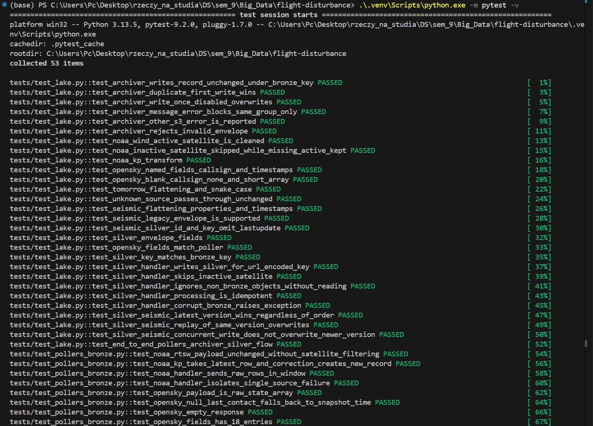

**Figure 2:** Local `pytest -v` output (Part 2/2) – Remaining ingestion poller tests (`tests/test_pollers_bronze.py`, 16 tests total; full repository suite: `53 passed in 0.34s`).  
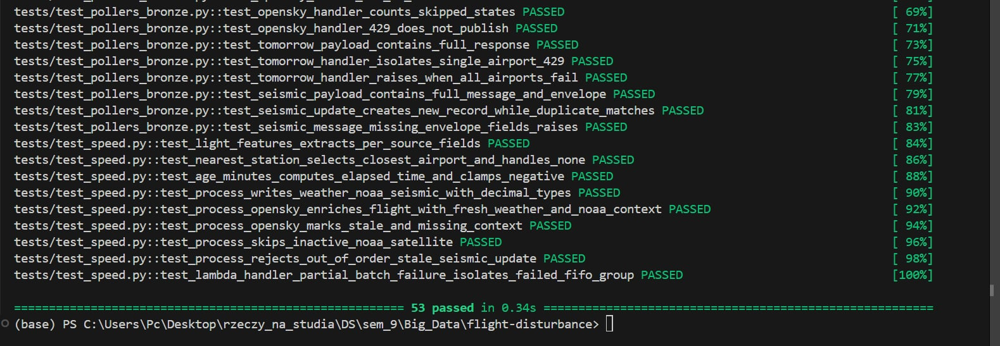

**Figure 3:** Local Terraform unit tests (`terraform -chdir=infra test`) – `Success! 3 passed, 0 failed.`  
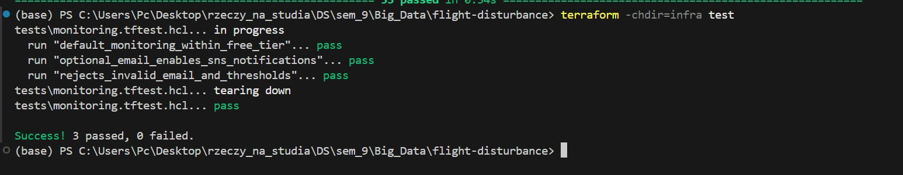

---

### Operational Monitoring & Incident Detection (AWS CloudWatch)

**Figure 4:** CloudWatch Dashboard `flight-disruption-pipeline` (top half) – all 10/10 alarms `OK`, steady SQS traffic (`Visible = 0`), monitored DLQ at `0`.  
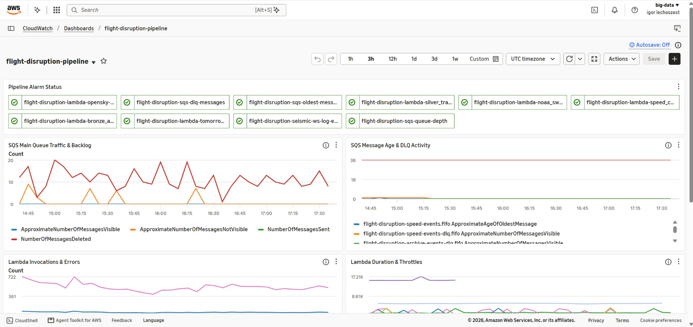

**Figure 5:** CloudWatch Dashboard `flight-disruption-pipeline` (bottom half) – Lambda Invocations/Duration, `Seismic WebSocket Log Errors` (`0`), and ECS Fargate utilization (`Memory ~8.2%`, `CPU ~0.04%`).  
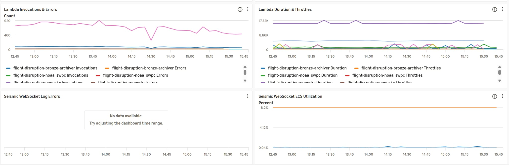

**Figure 6:** Real incident detection on `flight-disruption-pipeline` – `sqs-dlq-messages` and `lambda-opensky-errors` (`~17.4s` ConnectTimeout) in `ALARM` while remaining 8 alarms stayed `OK` (fault isolation).  
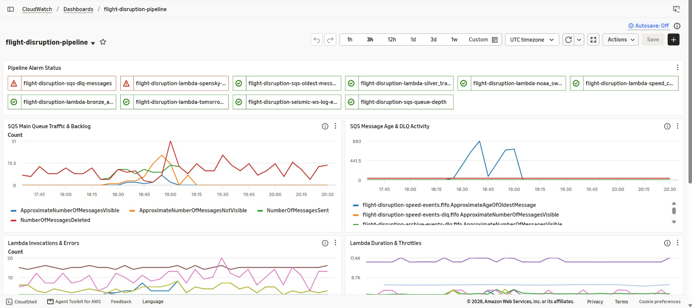

---

### S3 Data Lake & Data Transformation Quality (`bronze/` -> `silver/`)

**Figure 7:** S3 Data Lake `bronze/` Hive-partitioned structure across all 4 sources (`noaa_swpc`, `opensky`, `seismic`, `tomorrow_io`).  
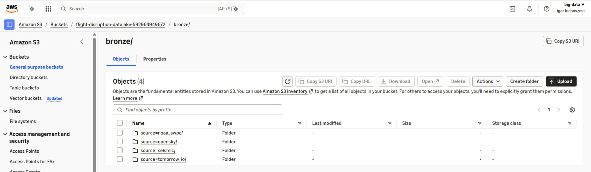

**Figure 8:** S3 Data Lake `silver/` Hive-partitioned structure mirroring all 4 sources after automated `silver_transform` processing.  
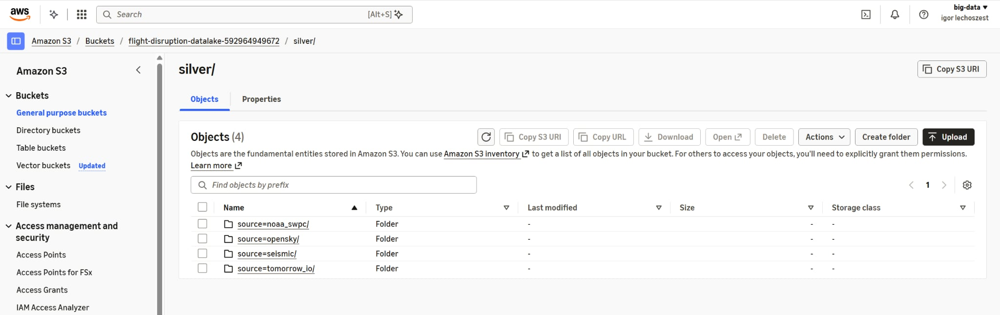

**Figure 9:** Quality Test – OpenSky live record (`opensky_010109_1795352490.json`, flight `MSR731`): raw 18-element array in `bronze/` (left) vs named fields, trimmed `callsign`, ISO UTC timestamps, and dropped `sensors` in `silver/` (right).  
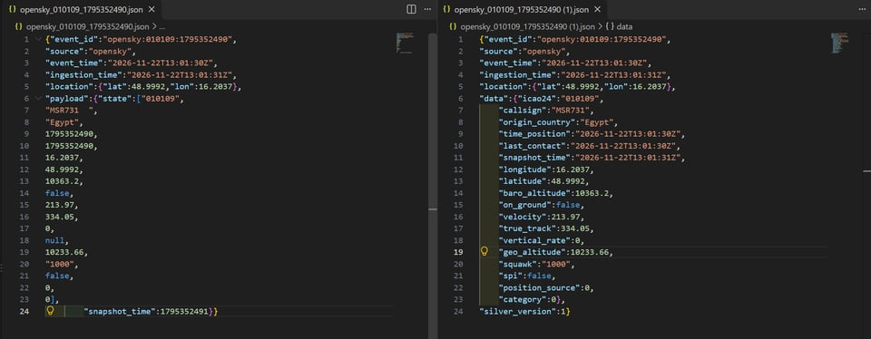

**Figure 10:** Quality Test – Tomorrow.io live record (`tomorrow_io_EPGD_2026-11-22T00_03_00Z.json`, Gdańsk Airport `EPGD`): nested `camelCase` API payload in `bronze/` (left) vs flattened `snake_case` schema in `silver/` (right).  
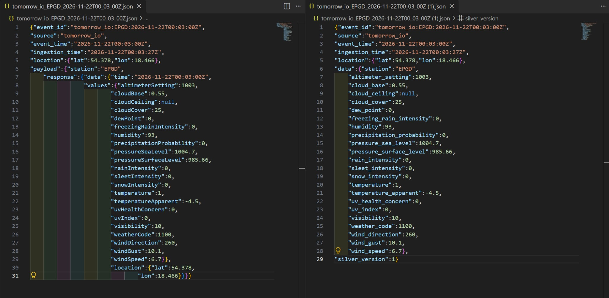

**Figure 11:** Seismic `LATEST_WINS` Verification (Bronze) – `bronze/source=seismic/date=2026-11-22/` retains all **325** immutable event versions, including 2 revisions of `20261122_0000219` (`17:00:09` and `17:01:34`).  
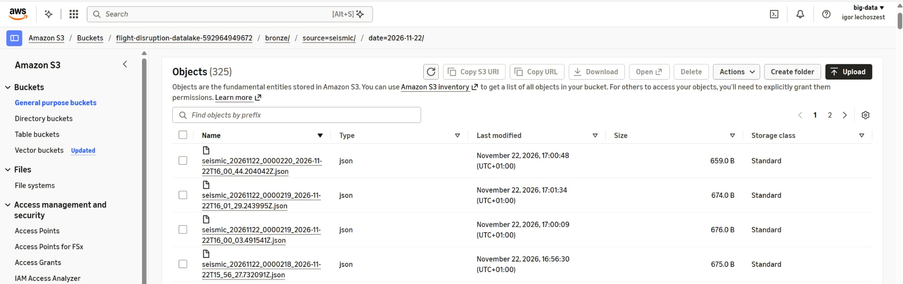

**Figure 12:** Seismic `LATEST_WINS` Verification (Silver) – `silver/source=seismic/date=2026-11-22/` stores **221** deduplicated entities with a single latest object `seismic_20261122_0000219.json` (`Last modified: 17:01:34`).  
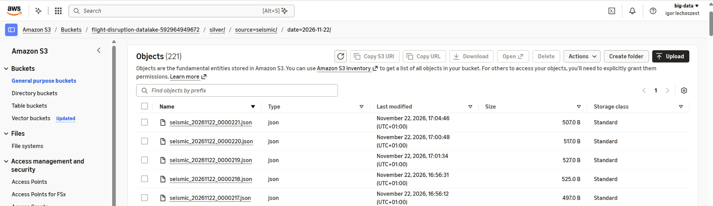

**Figure 13:** OpenSky AWS IP blocking diagnosis – `bronze/source=opensky/date=2026-11-21/` contained only the single manual smoke test (`opensky_smoke01_1795272660.json`) prior to enabling `scripts/run_poller_local.py`.  
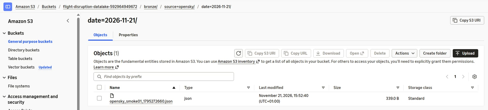

---

### Live AWS Lambda Execution Logs (CloudWatch Logs)

**Figure 14:** CloudWatch Logs for `/aws/lambda/flight-disruption-bronze-archiver` (`2026-11-22T17:53Z`, `325–355 ms`, `94 MB / 256 MB`, 0 errors, `10/10` alarms `OK`).  
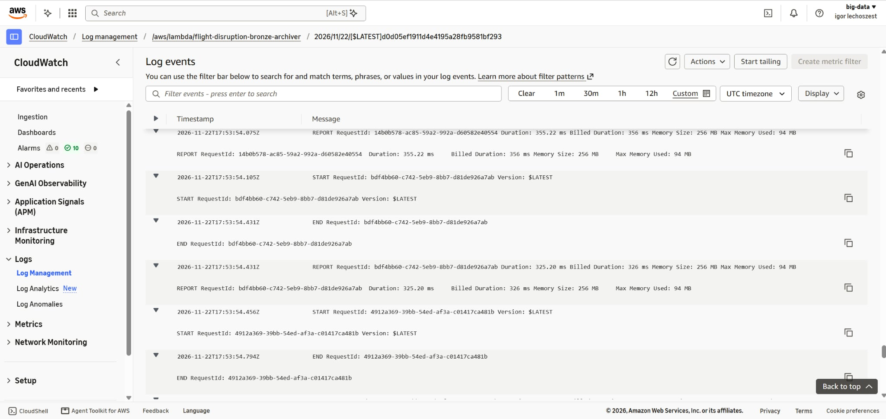

**Figure 15:** CloudWatch Logs for `/aws/lambda/flight-disruption-silver-transform` (`2026-11-22T16:06–16:07Z`, `81–104 ms`, `93 MB / 256 MB`, 0 errors, `10/10` alarms `OK`).  
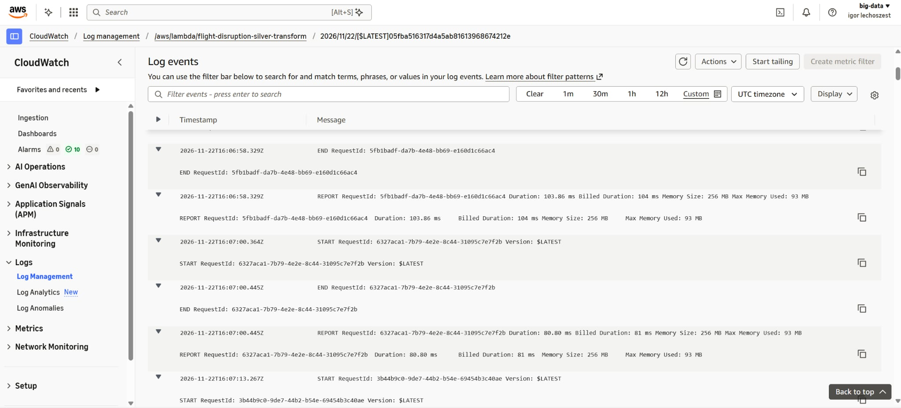
